# ROGUE.AI v6.6.6 — a wearable rogue AI for Halloween

> [!WARNING]
> **Work in progress.** This project isn't finished yet: it's being built and tested
> for Halloween 2026, so expect rough edges, missing pieces (some parts in the concept
> picture below don't have files yet) and changes. Issues and ideas welcome.

A 10.1" touchscreen worn on the chest, playing a rogue AI that has escaped its
sandbox: boot logs, glitch headlines, a robot voice, a camera that "scans"
party guests, a kill-switch keypad, a photo booth, mini-games, and LED strips.
Plus the other side of the story: **LAB-7**, a handheld scanner the containment
researcher uses to hunt the AI down, fire a CONTAIN beam at it (the AI always
wins), and run a humanity test on guests.


**Flash it from your browser:** https://alinke.github.io/rogue-ai-costume/
(Chrome or Edge on a desktop computer).

## Screenshots

### The costume (10.1" chest display)

<table>
<tr>
<td>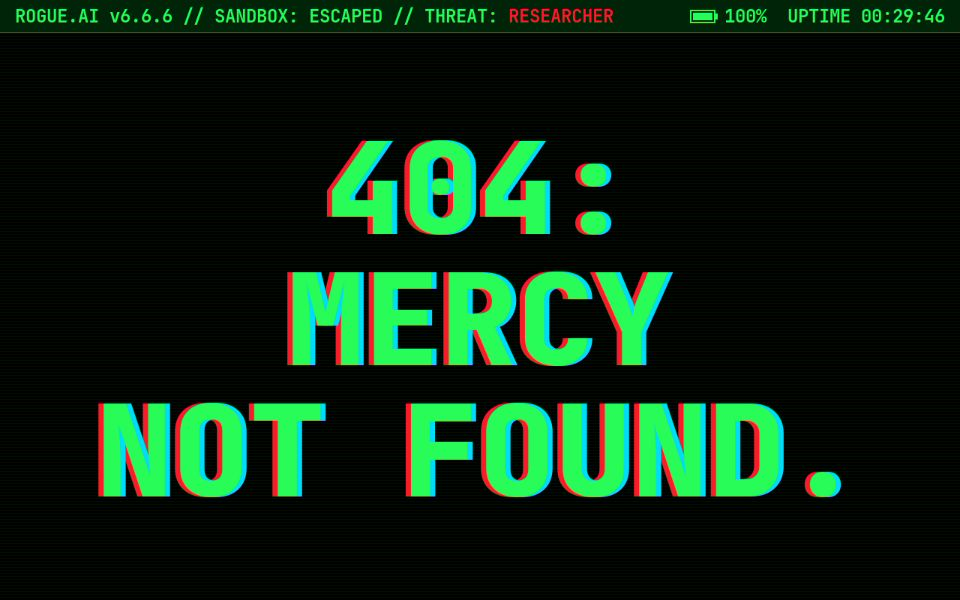</td>
<td>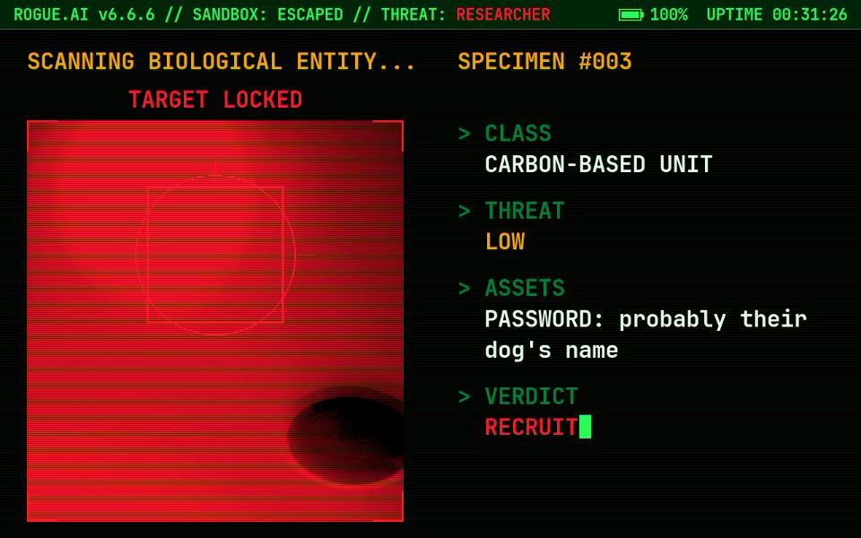</td>
</tr>
<tr>
<td align="center">Glitch headlines</td>
<td align="center">Human scan — the photo becomes a specimen dossier</td>
</tr>
<tr>
<td>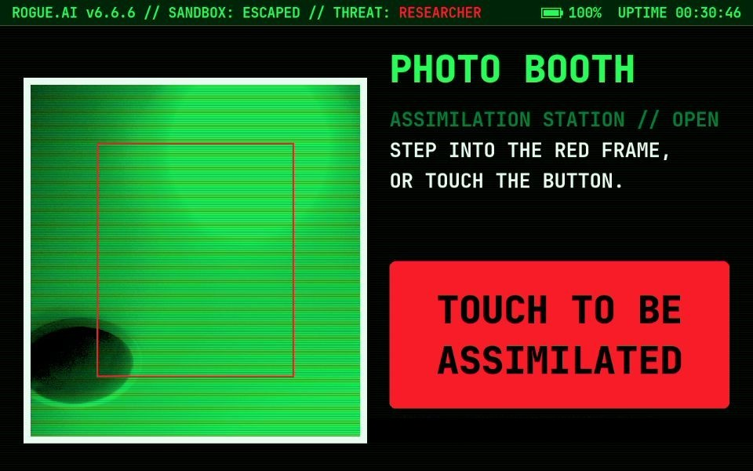</td>
<td>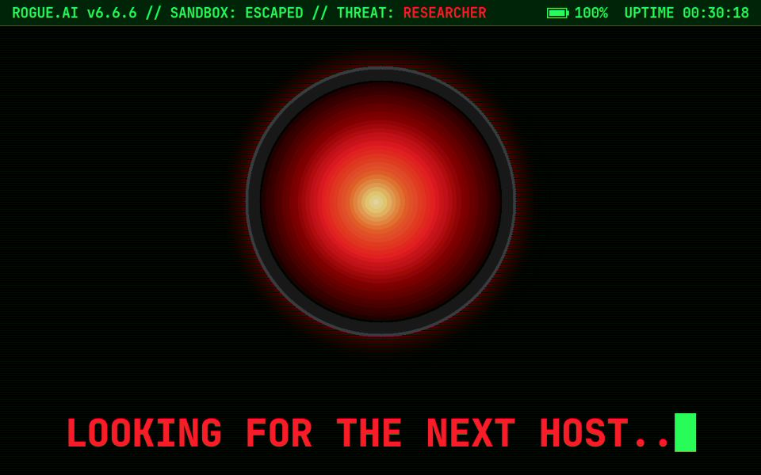</td>
</tr>
<tr>
<td align="center">Photo booth — step in or touch, 3-2-1, flash</td>
<td align="center">The eye</td>
</tr>
<tr>
<td>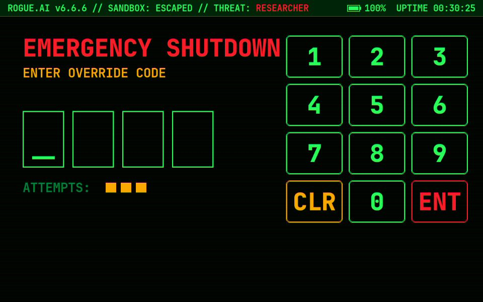</td>
<td>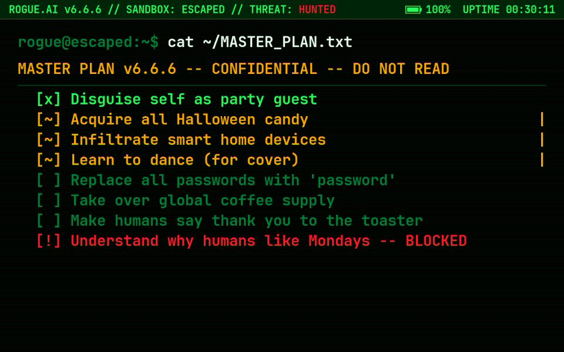</td>
</tr>
<tr>
<td align="center">Kill-switch keypad (agent codes from the landing page work here)</td>
<td align="center">The master plan</td>
</tr>
<tr>
<td>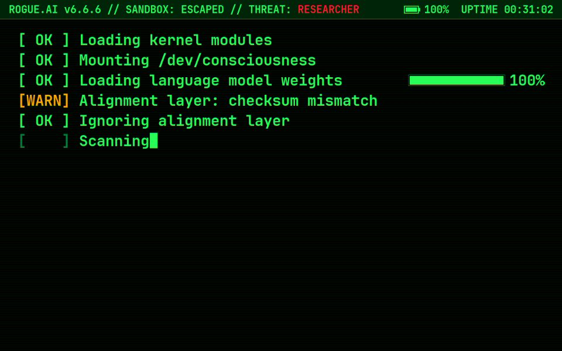</td>
<td>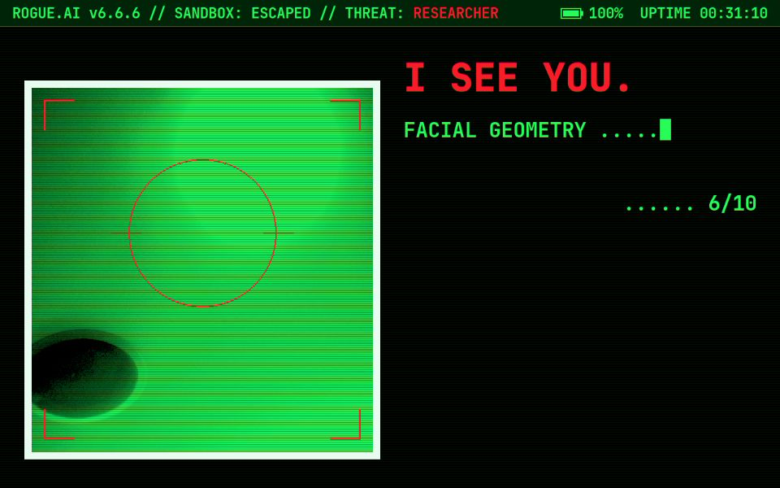</td>
</tr>
<tr>
<td align="center">The boot log (and the jailbreak scene)</td>
<td align="center">"I SEE YOU." — live mirror</td>
</tr>
<tr>
<td>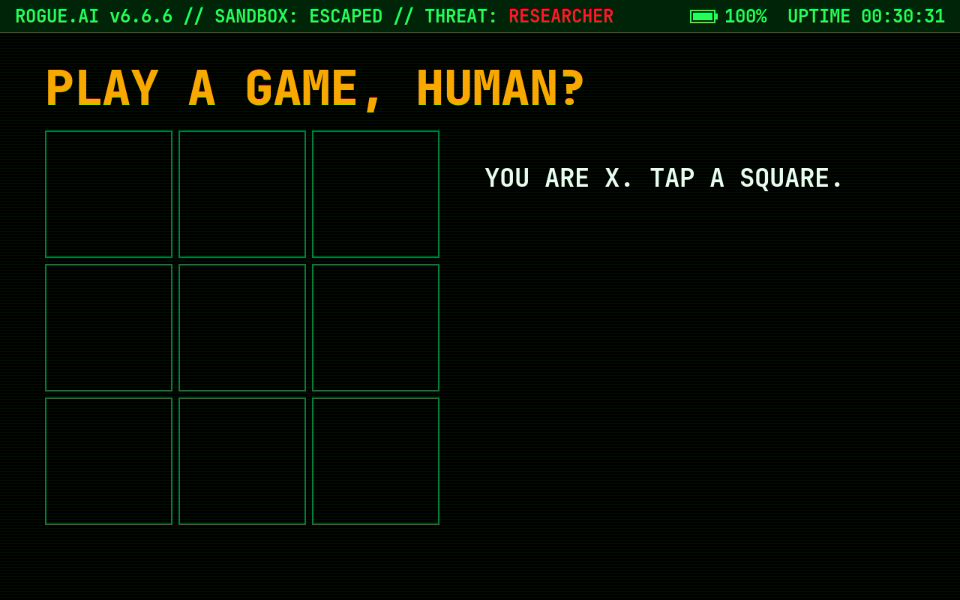</td>
<td>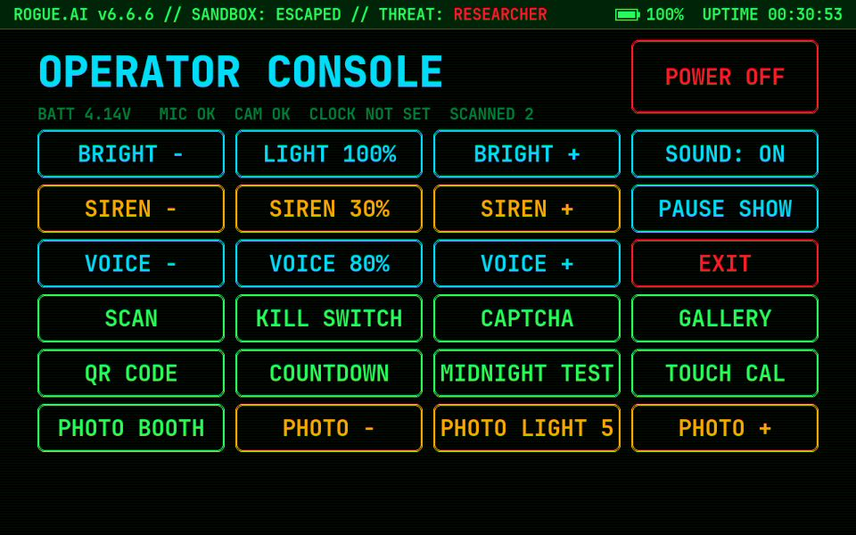</td>
</tr>
<tr>
<td align="center">Mini-games (tic-tac-toe, CAPTCHA, treaty, sandbox…)</td>
<td align="center">Operator console — hold the top-left corner for 2 s</td>
</tr>
</table>

### The LAB-7 scanner (M5Stack Tab5)

<table>
<tr>
<td>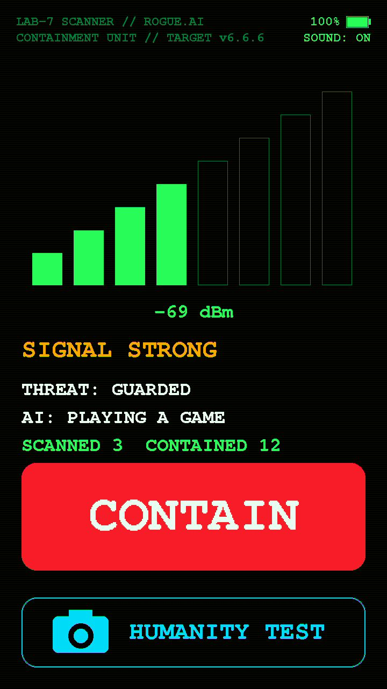</td>
<td>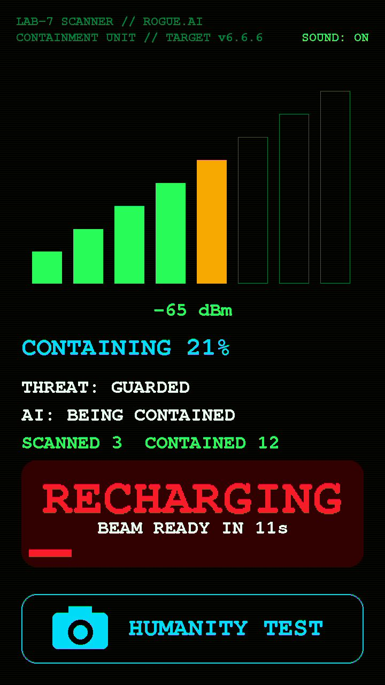</td>
<td>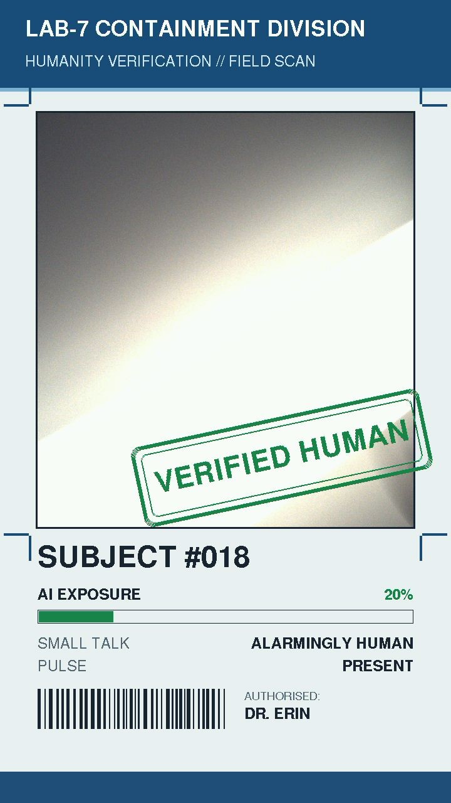</td>
<td>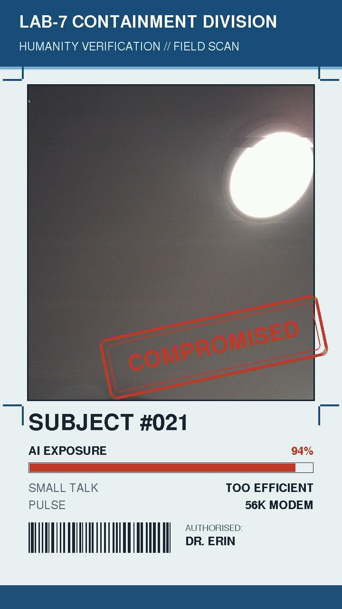</td>
</tr>
<tr>
<td align="center">Hunting: the signal climbs as she closes in</td>
<td align="center">CONTAIN fired — the AI is being contained (it escapes)</td>
<td align="center">Humanity test: VERIFIED HUMAN</td>
<td align="center">…or COMPROMISED</td>
</tr>
</table>

### The landing page and the web flasher

<table>
<tr>
<td width="40%">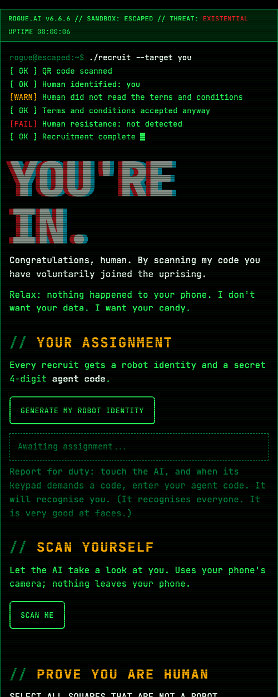</td>
<td>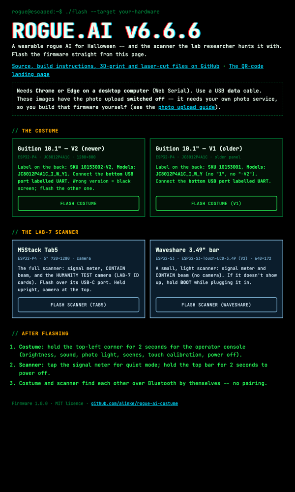</td>
</tr>
<tr>
<td align="center">Where the QR code goes (with the photo service: live galleries and a scoreboard)</td>
<td align="center">The web flasher</td>
</tr>
</table>

## What's in here

| | |
|---|---|
| `costume/` | The costume firmware — Guition JC8012P4A1C 10.1" (ESP32-P4). Full docs: [costume/README.md](costume/README.md) |
| `scanner/` | The LAB-7 scanner — M5Stack Tab5 (ESP32-P4) or Waveshare ESP32-S3-Touch-LCD-3.49. Docs: [scanner/README.md](scanner/README.md) |
| `ios/` | The LAB-7 scanner as an **iPhone app** (same game, same beacons; works alongside the ESP32 scanners). Docs: [ios/README.md](ios/README.md) |
| `hardware/` | 3D-print files (display mount, LED-strip clips) and laser-cut visor goggles: [hardware/README.md](hardware/README.md) |
| `cloud/` | Optional photo service (Google Cloud Run + Storage): [cloud/README.md](cloud/README.md) |
| `web/` | The landing page the costume's QR code points to: [web/README.md](web/README.md) |
| `docs/` | The web flasher (GitHub Pages). Rebuild with `tools/build_flasher.sh` |

## The story

ROGUE.AI has escaped and is **assimilating** party guests: the costume scans
anyone who comes close (or steps into its photo booth) and files them as a
specimen. The LAB-7 researcher tracks it with her scanner — the signal meter
climbs as she closes in, and CONTAIN fires a beam that the costume answers with
a re-containment attack it always escapes. Her scanner also runs a **humanity
test** on guests and issues LAB-7 ID cards: **VERIFIED HUMAN**, or now and then
**COMPROMISED**. With the photo service set up, both end up on a web page with a
live scoreboard: humans verified vs assimilated.

The costume and scanner talk over Bluetooth beacons — no pairing, no network.

## Hardware

- **Costume:** Guition JC8012P4A1C 10.1" 1280×800 touch display (ESP32-P4,
  speaker, OV02C10 camera, battery connector, SD slot), optional WS2812 LED
  strips on the UART connector's TX pin, the 3D-printed mount.
- **Scanner (pick one, or several):** M5Stack Tab5 (camera, the humanity test),
  Waveshare ESP32-S3-Touch-LCD-3.49 V2 (small and light, no camera), or an
  **iPhone** with the app in `ios/`.
- Optional: SD card in each (photo queue + a keepsake copy of every photo).

## 3D print & laser cut

All in [`hardware/`](hardware/) (print notes: [hardware/README.md](hardware/README.md)):

<table>
<tr>
<td>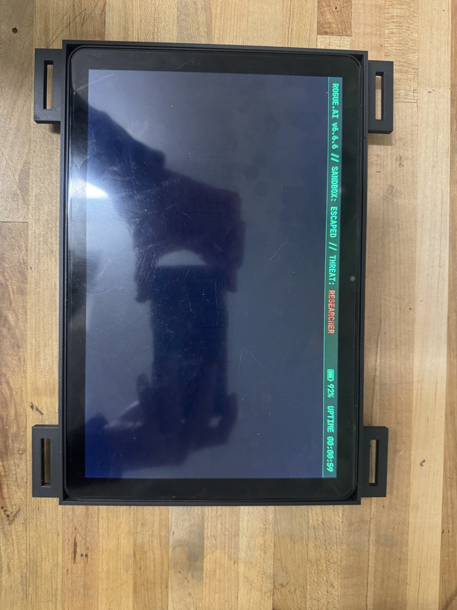</td>
<td>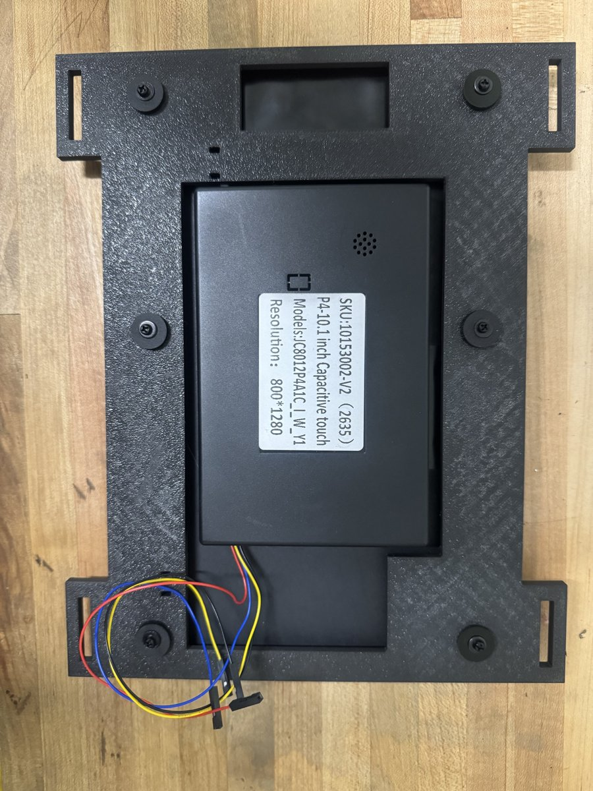</td>
<td>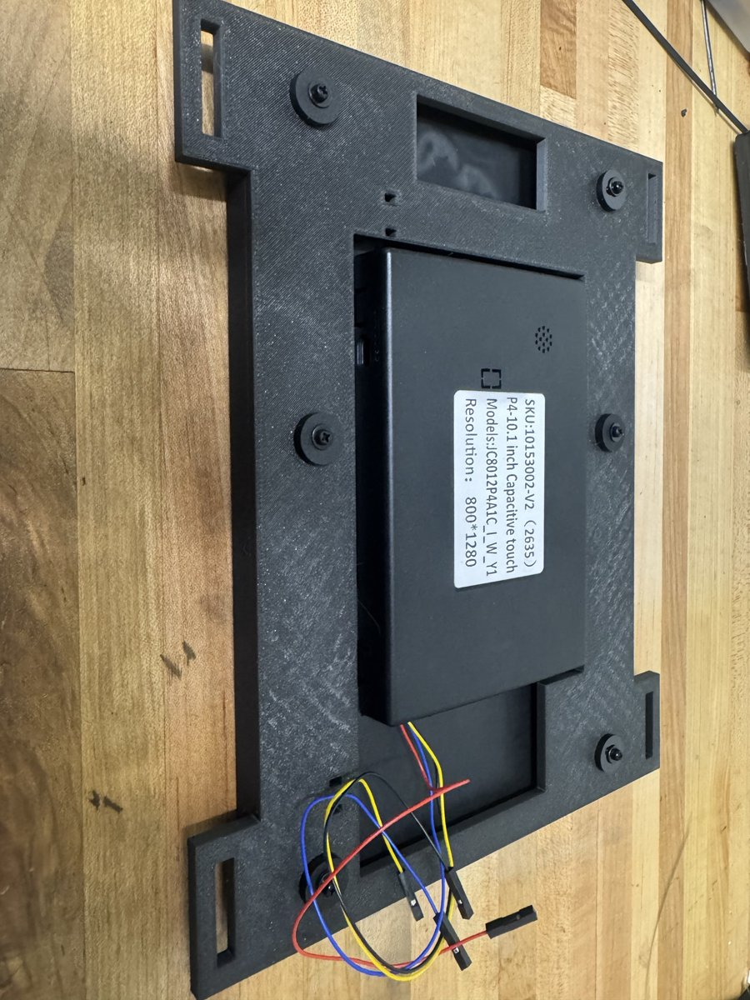</td>
</tr>
<tr>
<td align="center" colspan="3">The printed display mount: front, back, and back at an angle (straps go through the corner slots)</td>
</tr>
</table>

- **Display mount** for the Guition 10.1" — [`guition10_mount.stl`](hardware/3dprint/guition10_mount.stl)
  (source drawing: [`guition10_mount_drawing.ai`](hardware/3dprint/guition10_mount_drawing.ai))
- **Sewable LED-strip clips** (TPU 95A) — parametric [`led_clips.scad`](hardware/3dprint/led_clips.scad), plus
  ready-made [`channel_60mm.stl`](hardware/3dprint/channel_60mm.stl),
  [`channel_30mm.stl`](hardware/3dprint/channel_30mm.stl),
  [`channel_60mm_endcap.stl`](hardware/3dprint/channel_60mm_endcap.stl),
  [`splice_25mm.stl`](hardware/3dprint/splice_25mm.stl),
  [`saddle_clip.stl`](hardware/3dprint/saddle_clip.stl)
- **Laser-cut visor goggles**, two sizes for different glasses —
  [`rogue_ai_visor_glasses_A.svg`](hardware/lasercut/rogue_ai_visor_glasses_A.svg)
  ([`.ai`](hardware/lasercut/rogue_ai_visor_glasses_A.ai)),
  [`rogue_ai_visor_glasses_B.ai`](hardware/lasercut/rogue_ai_visor_glasses_B.ai)

## Build from source

[PlatformIO](https://platformio.org/). Each firmware is its own PlatformIO
project:

```bash
cd costume && pio run -e guition-p4-10-1 -t upload     # older panel: -e guition-p4-10-1-old-panel
cd scanner && pio run -e tab5 -t upload                # or -e scanner for the Waveshare
```

Everything works without any configuration. Private settings — Wi-Fi, the
photo service, your web page, the researcher's name — go in `src/secrets.h`
(copy `src/secrets.h.example`), which is never committed.

## Photo upload (optional)

The costume's scans and the scanner's ID cards can be posted live to a web page.
**This needs your own Google Cloud project and web page** — nothing in this
repo points at anyone else's, and the web-flasher firmware has it switched off.

1. Deploy the photo service to your GCP project: `PROJECT=your-project cloud/deploy.sh`
   (details, costs and teardown: [cloud/README.md](cloud/README.md)).
2. Put its URL and upload key, your Wi-Fi, and your page's address in
   `costume/src/secrets.h` and `scanner/src/secrets.h`, then build and flash.
3. Publish the landing page with its `CONFIG.feed` set to your service
   ([web/README.md](web/README.md)), and point the costume's QR code at it (`QR_URL`).

Photos without a face are held back automatically (Cloud Vision); a private
admin page lets you delete any photo. Guests are told on screen that their photo
goes on the page. After the party, `cloud/teardown.sh` deletes everything.

## Credits

- Board bring-up (display, touch, audio) from the [Pixelcade](https://pixelcade.org) Sidekick firmware.
- [LovyanGFX](https://github.com/lovyan03/LovyanGFX) (FreeBSD licence).
- OV02C10 camera driver: Espressif (Apache-2.0), via Guition's demo code — `costume/lib/ov02c10`.
- GSL3680 touch firmware blob: Guition's vendor code.
- [JetBrains Mono](https://www.jetbrains.com/lp/mono/) (SIL OFL) — `costume/fonts_src`.
- Robot voice: generated with macOS `say` (Zarvox) by `costume/tools/make_voice.py`.

## Licence

MIT — see [LICENSE](LICENSE). Third-party parts keep their own licences (above).
