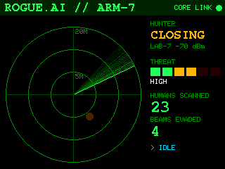

# ARM-7 — ROGUE.AI's forearm terminal

A 2.4" touch screen worn on the costume's forearm: the AI's own heads-up
display. It **only listens** to the Bluetooth beacons the costume and the
LAB-7 scanners already send, so nothing else needs changing or pairing.



## What it does

- **Hunter radar.** The researcher's scanner (the Tab5, the Waveshare or the
  iPhone app) shows as a blip that closes in as her signal gets stronger:
  `CLEAR` → `TRACKING` → `CLOSING` → `CRITICAL`. Distance comes from signal
  strength; the blip's direction is made up (Bluetooth can't tell direction).
  Handy for the wearer: you can't see your own chest screen, but you can glance
  at your arm.
- **The AI's status**, from the costume's beacon: threat level, humans scanned,
  beams evaded, and what it's doing right now. `CORE LINK` / `CORE LOST` in the
  top corner shows whether the costume is in range.
- **The beam.** When she presses CONTAIN, the armband reacts straight from her
  scanner's beacon (it doesn't wait for the costume): a white `!! INCOMING !!`
  flash, the red/white `CONTAINMENT BEAM DETECTED` strobe for as long as the
  costume is being contained, then `BEAM DEFLECTED — CONTAINMENT FAILED. AGAIN.`
  The costume's midnight takeover gets its own screen too.
- **Touch it** and it snaps `UNAUTHORISED ORGANIC CONTACT`.
- **The RGB LED (LED1, on the front)** follows all of it:

| Situation | LED |
|---|---|
| Costume in range, all calm | green heartbeat (lub-dub) |
| Researcher detected / closing | orange pulse, faster as she gets closer |
| Researcher at arm's length | red strobe |
| Beam fired | white burst, then red/white strobe; green when it's deflected |
| Takeover, or a guest touches it | fast red blink |
| Costume not found | slow blue blink |

At power-on the LED blinks red, green, blue once (a wiring check).

- **Battery gauge** in the top bar (icon + %): green, amber below 40%, red and
  blinking below 15%. Needs a small mod -- the board can't measure its battery
  by itself (see Hardware). Without the mod the gauge just doesn't show.
- **Standby:** hold the screen 3 s ("CORE LINK SEVERED"): screen, LED and
  Bluetooth off; a tap brings it back. Still draws a few mA -- the slide switch
  in the battery wire is the real off.

## Hardware

Sunton **ESP32-2432S024C**: 2.4" 320×240 ILI9341, CST820 capacitive touch,
classic ESP32 (Bluetooth built in), RGB LED, and a charger for a 3.7 V LiPo on
its BAT connector (JST 1.25 mm 2-pin). Mount, battery and switch:
[../hardware/README.md](../hardware/README.md).

**Battery gauge mod:** two 100 kΩ resistors in series from the battery's +
(on the board side of the power switch) to GND; the point between them to
**GPIO35**. GPIO35 and GND are on the board's 4-pin connector **P3**
(IO21, IO22, IO35, GND -- a JST 1.25 mm 4-pin pigtail). The divider halves
the battery's 3.5-4.2 V into the ESP32's range and draws 0.02 mA. Other
resistor values: `BATTERY_DIVIDER` in `src/config.h`.

## Flash it

From the [web flasher](https://alinke.github.io/rogue-ai-costume/), or:

```bash
cd armband && pio run -t upload
```

## Settings (`src/config.h`)

| Setting | Default | |
|---|---|---|
| `ROTATION` | 3 | 1 = turned 180°, if it reads upside down on your arm |
| `BACKLIGHT_PERCENT`, `BACKLIGHT_IDLE_PERCENT` | 60, 20 | dims after a minute without the costume |
| `NEAR_DBM`, `CLOSE_DBM` | -70, -58 | same as the costume's, so both agree on "near" |
| `LED_MAX_PERCENT` | 60 | the LED is bright |
| `LED_R_PIN`/`G`/`B`, `LED_ACTIVE_LOW` | 4, 16, 17, 1 | |
| `BATTERY_SENSE_PIN`, `BATTERY_DIVIDER` | 35, 2.0 | the battery gauge mod; -1 = no gauge |
| `POWER_HOLD_MS` | 3000 | hold the screen this long for standby |

## Serial (115200)

A status line every 5 s. Commands: `d` demo mode (a made-up costume and a
researcher walking up and away), `b` a beam, `1`–`4` the beam / deflected /
takeover / touch screens, `s` a screenshot (PPM between `@@PPM@@` and `@@END@@`).
