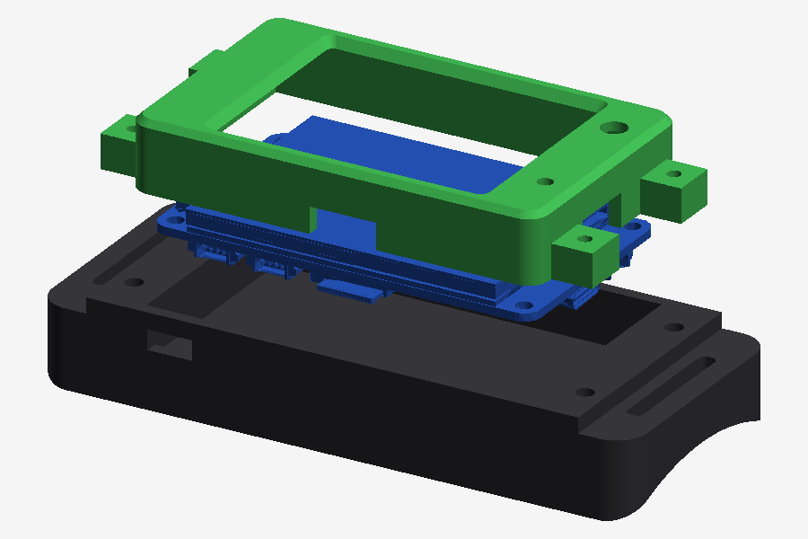

# Hardware

## 3D print (`3dprint/`)

The display mount, printed, with the Guition 10.1" (V2, `JC8012P4A1C_I_W_Y1`) in it.
The four slots at the corners take straps; the screen faces out and the board's
back stays reachable (USB ports, SD card, the UART/LED connector).

<table>
<tr>
<td></td>
<td></td>
<td></td>
</tr>
<tr>
<td align="center">Front</td>
<td align="center">Back</td>
<td align="center">Back, angled</td>
</tr>
</table>

| File | What |
|---|---|
| `guition10_mount.stl` | Mount for the Guition 10.1" JC8012P4A1C display on the costume's chest. `guition10_mount_drawing.ai`: the source drawing. |
| `led_clips.scad` | Sewable clips for WS2812 LED strips (OpenSCAD, parametric — measure your strip and set `strip_w` / `strip_t`; pick a `part`, render, export). |
| `channel_60mm.stl`, `channel_30mm.stl` | Straight strip channels, 60 / 30 mm (from `led_clips.scad`). |
| `channel_60mm_endcap.stl` | Channel with a closed end. |
| `splice_25mm.stl` | Joins two strip ends. |
| `saddle_clip.stl` | Saddle clip for crossing a seam. |

### ARM-7 armband mount (2.4" CYD + 2000 mAh battery, forearm)

<table>
<tr>
<td></td>
<td></td>
</tr>
<tr>
<td align="center">Assembled (renders, not yet printed)</td>
<td align="center">Bezel, board, pod</td>
</tr>
</table>

| File | What |
|---|---|
| `armband_mount.py` | The source (Python + `manifold3d`): your arm size, strap width, battery size and fit at the top; `python3 armband_mount.py` rewrites the two STLs. |
| `armband_bezel.stl` | Front: frames the screen, holds the board on its four M3 holes, windows for the RGB LED and the light sensor, cut-outs for USB-C and the SD card. |
| `armband_pod.stl` | Back: battery compartment, a slot for a power switch, a saddle curved to the forearm (330 mm round, over a jacket), strap slots for a 25 mm strap at both ends. |

Fitted to the board's own 3D model, checked for collisions with it; about
116 x 49 mm, 26 mm tall at the centre. The arm runs along the long side.

**You also need:** 4x M3x6 screws (board into bezel), 4x M3x10 (pod onto
bezel, from underneath), a 3.7 V LiPo (2000 mAh, 58 x 38 x 9 mm) with a
**JST 1.25 mm 2-pin plug** (check polarity against the board's silkscreen
before plugging in -- these plugs come both ways round), a mini slide switch
(SS12D00 or similar), a 25 mm strap (hook-and-loop or elastic), foam tape.

**Print:** PETG (or PLA), 0.2 mm, 3 walls. Bezel front-face down, no supports.
Pod upside down (open side on the bed) with supports for the floor.

**Assemble:** board screen-down into the bezel, four M3x6 screws through the
board into the posts. Cut the battery's red wire and solder the slide switch in
(glue it into its slot from the inside; insulate the joints). Battery into the
pod toward the end away from the switch, held with foam tape; plug it into the
board's BAT connector (the one next to the speaker connector on the top edge).
Pod onto the bezel, four M3x10 screws from underneath. Strap through the slots.

**Charging:** the board charges the battery itself through its USB-C port (it
has a power-bank chip, U8 in the schematic), with the switch **on**. The switch
off = fully off, no standby drain.

The LED parts are made to print in **TPU 95A**, flat, no supports, and get
sewn on through their flange holes.

## Laser cut (`lasercut/`)

The ROGUE.AI visor goggles, in two sizes for different glasses:
`rogue_ai_visor_glasses_A.svg` (+ `.ai` source) and `rogue_ai_visor_glasses_B.ai`.

## Wiring

- **LED strips:** one chained run of WS2812 strips on the Guition's UART
  connector **TX pin (GPIO37)** + 5 V + GND. Enable and lay out the chain in
  `costume/src/config.h` (`LED_STRIP_ENABLED`, `LED_CHAIN`). See
  `costume/README.md`, "LED strip".
- **Battery:** the Guition has a battery connector (IP5306 charger); the
  Waveshare scanner takes a 3.7 V LiPo on its MX1.25 2-pin connector; the Tab5
  uses its NP-F battery. The ARM-7 armband's 2.4" CYD charges a 3.7 V LiPo on
  its JST 1.25 mm 2-pin BAT connector (power-bank chip on board).
