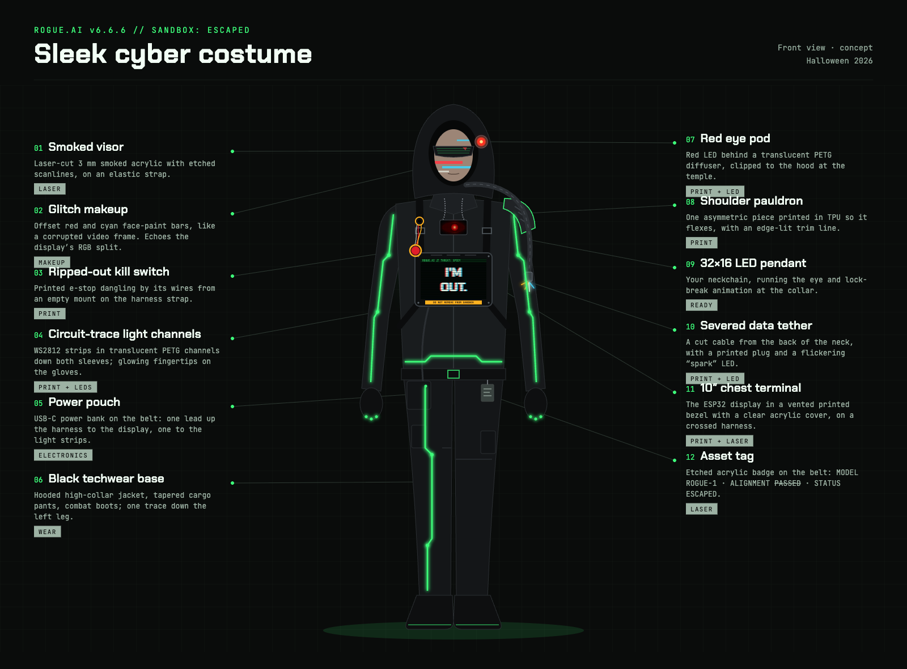
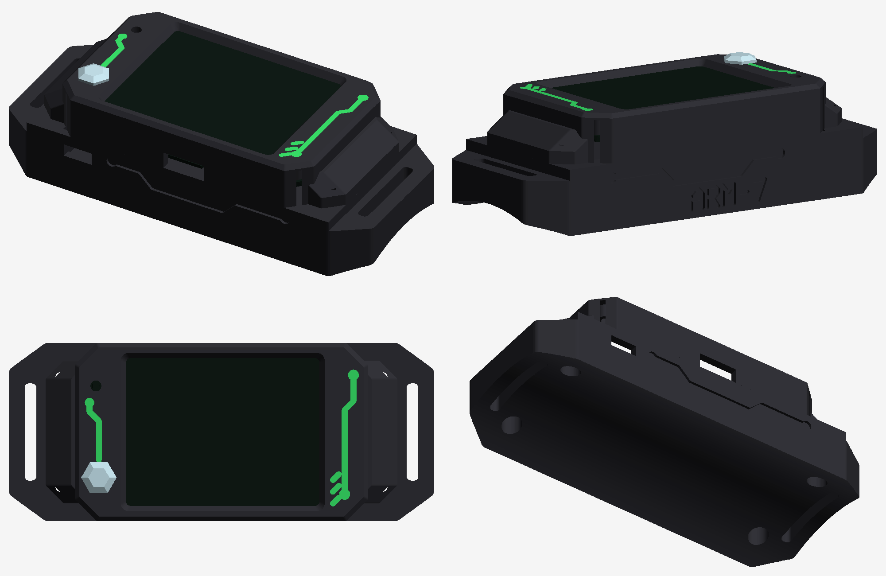
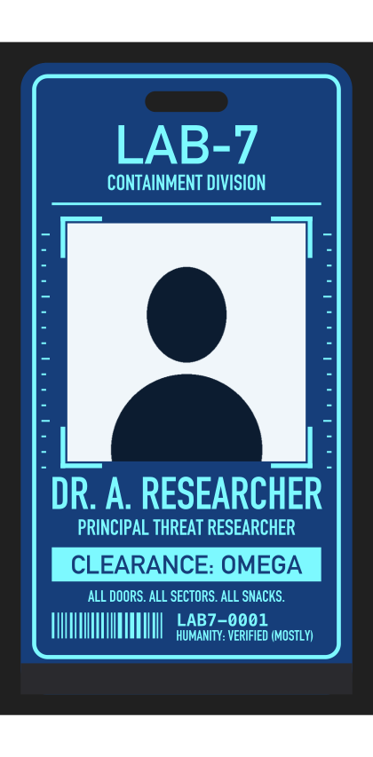

# Hardware

## 3D print (`3dprint/`)

The display mount, printed, with the Guition 10.1" (V2, `JC8012P4A1C_I_W_Y1`) in it.
The four slots at the corners take straps; the screen faces out and the board's
back stays reachable (USB ports, SD card, the UART/LED connector).

<table>
<tr>
<td></td>
<td></td>
<td></td>
</tr>
<tr>
<td align="center">Front</td>
<td align="center">Back</td>
<td align="center">Back, angled</td>
</tr>
</table>

| File | What |
|---|---|
| `guition10_mount.stl` | Mount for the Guition 10.1" JC8012P4A1C display on the costume's chest. `guition10_mount_drawing.ai`: the source drawing. |
| `led_clips.scad` | Sewable clips for WS2812 LED strips (OpenSCAD, parametric — measure your strip and set `strip_w` / `strip_t`; pick a `part`, render, export). |
| `channel_60mm.stl`, `channel_30mm.stl` | Straight strip channels, 60 / 30 mm (from `led_clips.scad`). |
| `channel_60mm_endcap.stl` | Channel with a closed end. |
| `splice_25mm.stl` | Joins two strip ends. |
| `saddle_clip.stl` | Saddle clip for crossing a seam. |
| `badge_led_base.stl` | The researcher badge's LED base: clips onto the badge's bottom edge, two 3 mm LEDs light the clear layer's edge, a cradle for a 1 x CR2032 holder with switch (23.9 x 34.1 mm). See [badge/](badge/README.md). |

### ARM-7 armband mount (2.4" CYD + 2000 mAh battery, forearm)

*Renders, not yet printed.* Angular like the visor, black like the techwear,
with green circuit traces like the costume's light channels.

| File | Print in | What |
|---|---|---|
| `armband_bezel.stl` | matte black PETG | Front: frames the screen, holds the board on its four M3 holes, LED and light-sensor windows, cut-outs for USB-C and the SD card, sloped flanges for the pod's screws. |
| `armband_bezel_inlay.stl` | translucent neon-green PETG | The circuit traces, flush in the bezel's front (3 layers). |
| `armband_jewel.stl` | clear / natural PETG | The "status jewel": a faceted hex cap with a light pipe down to the RGB LED. |
| `armband_pod.stl` | matte black PETG | Back: battery compartment, power-switch cradle, a saddle curved to the forearm (330 mm round, over a jacket), and four strap tunnels through its long sides' bottom edges for two 25 mm straps round the arm. |
| `armband_pod_inlay.stl` | translucent neon-green PETG | The circuit traces down both long sides of the pod and the ARM-7 label, flush. |
| `armband_switch_cap.stl` | either | A cap glued onto the power switch's lever (which only just clears the case): ~3 mm more to push. Print a few; cap side down. |
| `armband_mount.py` | | The source (Python + `manifold3d`): arm size, strap width, battery size, fit and the trace layout at the top; `python3 armband_mount.py` rewrites the STLs. |

Fitted to the board's own 3D model and checked for collisions with it; about
100 x 49 mm, 26 mm tall at the centre. It sits lengthwise along the forearm.

**Colours.** With a multi-colour printer (AMS): load `armband_bezel.stl` and
`armband_bezel_inlay.stl` together as one object (Bambu Studio / Orca: add the
inlay as a part), black + green; the colour change is only in the first 3
layers, so very little purge. Single colour: print the bezel black and fill the
trace grooves with a green paint pen, or print the bezel in the green and keep
the pod black. The jewel is its own small print in clear.

**You also need:** 4x M3x6 screws (board into bezel), 4x M3x10 (pod onto
bezel, from underneath), a 3.7 V LiPo (2000 mAh, 58 x 38 x 9 mm) with a
**JST 1.25 mm 2-pin plug** (check polarity against the board's silkscreen
before plugging in -- these plugs come both ways round), a 3-pin mini slide
switch (11.55 x 4 x 6 mm body, lever 1.84 mm; other sizes: `SWITCH` in the script), two 25 mm straps, up to ~3 mm thick (hook-and-loop), foam tape.

**Print:** PETG (or PLA), 0.2 mm, **4 walls** (the screw posts then print
solid). Bezel front-face down, no supports.
Pod **on its side** (a long side on the bed), with `armband_pod_inlay.stl` added as a part
in green: the inlays sit on the two long sides, so the colour changes are only in the
first and last few layers. Jewel cap
down, no supports; press it into the LED window (a drop of clear glue).

**Assemble:** board screen-down into the bezel, four M3x6 screws through the
board into the posts -- just snug, don't crank them (the pilot holes are a
little oversize so they go in easily). Cut the battery's red wire and solder the slide switch in
(middle pin + one outer pin; insulate the joints). Push it down into its
cradle on the inside of the side wall (pins toward the middle, lever into the
slot) until it clicks under the two small catches; a dab of hot glue or epoxy
on top makes it permanent. The lever ends level with the outside, in a finger
recess. Battery into the
pod on the other side of the low rib, held with foam tape; plug it into the
board's BAT connector (the one next to the speaker connector on the top edge).
Pod onto the bezel, four M3x10 screws from underneath. Each strap goes round
the arm and under the pod: in through a tunnel in one long side, across under
the pod, out through the matching tunnel in the other side (the tunnels open on
the side faces and on the underside, near the edges).

**Battery gauge (optional):** two 100 kΩ resistors from the switched battery +
to GND, the middle to GPIO35 on the board's P3 connector -- see
[armband/README.md](../armband/README.md). They fit in the pod next to the
switch; heat-shrink them.

**Charging:** the board charges the battery itself through its USB-C port (it
has a power-bank chip, U8 in the schematic), with the switch **on**. The switch
off = fully off, no standby drain.

The LED parts are made to print in **TPU 95A**, flat, no supports, and get
sewn on through their flange holes.

## Laser cut (`lasercut/`)

The ROGUE.AI visor goggles, in two sizes for different glasses:
`rogue_ai_visor_glasses_A.svg` (+ `.ai` source) and `rogue_ai_visor_glasses_B.ai`.

### LAB-7 researcher badge (edge-lit acrylic)

The researcher's ID badge, 64 x 122 mm on a lanyard: 1/8" clear acrylic engraved
from behind over 1/8" blue, a printed photo between them, and two LEDs in the
printed base making the engraving glow. The files here are the **template**
(placeholder name, no photo); make your own with your name and photo with
[`badge/badge.py`](badge/README.md), which also writes the photo insert.

| File | What |
|---|---|
| `badge_front_clear_MIRRORED.svg` | 1/8" clear. Red = cut, black = engrave; mirrored -- engrave the face that goes against the photo. |
| `badge_back_blue_outer.svg` | 1/8" blue, engraved face up: the badge's back (the small print). |
| `badge_back_blue_inner_pocket.svg` | The same piece flipped: a shallow pocket for the photo. |

## Wiring

- **LED strips:** one chained run of WS2812 strips on the Guition's UART
  connector **TX pin (GPIO37)** + 5 V + GND. Enable and lay out the chain in
  `costume/src/config.h` (`LED_STRIP_ENABLED`, `LED_CHAIN`). See
  `costume/README.md`, "LED strip".
- **Battery:** the Guition has a battery connector (IP5306 charger); the
  Waveshare scanner takes a 3.7 V LiPo on its MX1.25 2-pin connector; the Tab5
  uses its NP-F battery. The ARM-7 armband's 2.4" CYD charges a 3.7 V LiPo on
  its JST 1.25 mm 2-pin BAT connector (power-bank chip on board).
